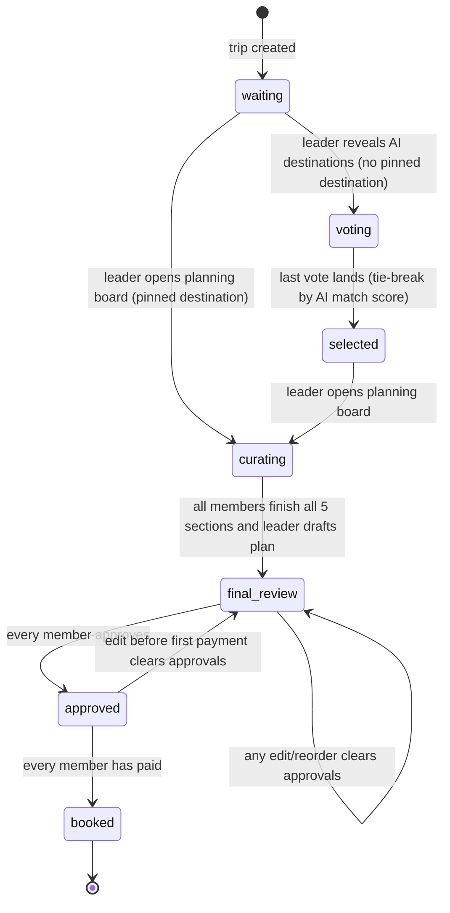

# Rovyn — Database Diagram & Reference

SQLite database at `backend/data/rovyn.db`, created and migrated automatically by
`backend/db.py` on startup (plain SQL — no ORM — so a future move to Postgres/Supabase
is mechanical). The diagram below renders automatically on GitHub.

## Entity-relationship diagram

```mermaid
erDiagram
    users {
        TEXT id PK "uuid"
        TEXT email UK
        TEXT name
        TEXT password_hash "PBKDF2-SHA256"
        TEXT created_at
    }

    auth_sessions {
        TEXT token PK "bearer token"
        TEXT user_id FK
        TEXT created_at
    }

    trips {
        TEXT id PK "uuid"
        TEXT name
        TEXT invite_code UK "6 chars, join code"
        TEXT leader_id FK "the trip leader"
        TEXT status "waiting | voting | selected | curating | final_review | approved | booked"
        TEXT destination "leader-pinned destination (nullable)"
        TEXT selected_destination "decided destination (pinned or vote winner)"
        TEXT recommendations "JSON: 5 AI destination proposals"
        INTEGER recommendations_generating "in-progress lock"
        TEXT options "JSON: planning board (flights/stay/itinerary/visits/events)"
        INTEGER options_generating "in-progress lock"
        TEXT final_plan "JSON: merged majority-rule plan"
        INTEGER final_plan_generating "in-progress lock"
        TEXT itinerary "JSON: legacy single-shot itinerary"
        INTEGER itinerary_generating "in-progress lock"
        TEXT created_at
    }

    trip_members {
        TEXT trip_id PK,FK
        TEXT user_id PK,FK
        TEXT joined_at
    }

    questionnaires {
        TEXT trip_id PK,FK
        TEXT user_id PK,FK
        TEXT data "JSON: dates, budget, departure city, vibes, stay style"
        TEXT submitted_at
    }

    votes {
        TEXT trip_id PK,FK
        TEXT user_id PK,FK
        TEXT destination_name "one vote per member, changeable until last vote"
    }

    stars {
        TEXT trip_id PK,FK
        TEXT user_id PK,FK
        TEXT category PK "flights | stay | itinerary | visits | events"
        TEXT option_id PK "e.g. stay-2, flight-london-1"
    }

    category_progress {
        TEXT trip_id PK,FK
        TEXT user_id PK,FK
        TEXT category PK
        TEXT status "done | no_preference"
        TEXT updated_at
    }

    approvals {
        TEXT trip_id PK,FK
        TEXT user_id PK,FK
        TEXT approved_at
    }

    payments {
        TEXT trip_id PK,FK
        TEXT user_id PK,FK
        INTEGER amount_cents
        TEXT currency "USD"
        TEXT receipt "JSON: itemized check snapshot"
        TEXT email_status "sent | simulated"
        TEXT paid_at
    }

    posts {
        TEXT id PK "uuid"
        TEXT user_id FK "author"
        TEXT trip_id FK "associated trip (nullable)"
        TEXT trip_snapshot "JSON: plan frozen at post time (nullable)"
        TEXT caption
        TEXT destination "denormalized for display"
        TEXT vibes "JSON: tags for feed personalization"
        TEXT created_at
    }

    post_media {
        TEXT id PK "uuid"
        TEXT post_id FK
        INTEGER position "carousel order"
        TEXT media_type "image | video"
        TEXT url "/media/... served from backend/data/media"
    }

    post_likes {
        TEXT post_id PK,FK
        TEXT user_id PK,FK
        TEXT liked_at
    }

    post_comments {
        TEXT id PK "uuid"
        TEXT post_id FK
        TEXT user_id FK
        TEXT text
        TEXT created_at
    }

    users ||--o{ auth_sessions : "signs in"
    users ||--o{ trip_members : "belongs to"
    users ||--o{ trips : "leads"
    trips ||--|{ trip_members : "has travelers"
    trips ||--o{ questionnaires : "collects"
    users ||--o{ questionnaires : "submits"
    trips ||--o{ votes : "destination vote"
    users ||--o{ votes : "casts"
    trips ||--o{ stars : "planning-board stars"
    users ||--o{ stars : "stars options"
    trips ||--o{ category_progress : "section completion"
    users ||--o{ category_progress : "locks in / doesn't mind"
    trips ||--o{ approvals : "final-plan sign-off"
    users ||--o{ approvals : "approves"
    trips ||--o{ payments : "equal-split charges"
    users ||--o{ payments : "pays share"
    users ||--o{ posts : "publishes"
    trips o|--o{ posts : "shared by"
    posts ||--|{ post_media : "photos / videos"
    posts ||--o{ post_likes : "hearts"
    users ||--o{ post_likes : "likes"
    posts ||--o{ post_comments : "discussion"
    users ||--o{ post_comments : "writes"
```

## Trip status lifecycle

## Design notes

- **JSON columns on `trips`** (`recommendations`, `options`, `final_plan`) hold whole AI
  artifacts. They are read/written as a unit and never queried by field, which keeps the
  schema stable while prompt output shapes evolve. On Postgres these become `jsonb`.
- **`*_generating` flags** are single-writer locks so two people can't trigger the same
  expensive AI generation twice; they are cleared on failure.
- **Composite primary keys** on all junction tables (`stars` is `(trip_id, user_id,
  category, option_id)`) make every user action idempotent — starring twice, re-approving
  or re-submitting a questionnaire simply upserts.
- **Group decisions are derived, not stored**: star tallies, majority winners, the equal
  split and each member's check are recomputed from these tables on demand
  (`ai_service.select_winners`, `trips._member_checks`), so there is no cached aggregate
  to drift out of sync. The one snapshot kept on purpose is `payments.receipt` — what a
  person was charged must never change retroactively.
- **Migrations** are split by engine. Postgres/Supabase schema is owned by the Supabase
  CLI: every structural change is a file in `supabase/migrations/`, applied with
  `supabase db push` (or by the Supabase GitHub integration on merge) — the app only
  VERIFIES the schema at startup and refuses to boot with instructions if it's behind
  (`db.py` `_SCHEMA_CANARIES`). SQLite (local dev, which the CLI doesn't manage) still
  self-migrates on startup via `_SCHEMA` + `_COLUMN_MIGRATIONS`, so pulling a newer
  branch never requires deleting the local database. A new column therefore touches
  three spots: the migration file, the SQLite lists, and a canary entry.
- **`posts.trip_snapshot` is a frozen copy** of the trip's plan at the moment of posting
  (same principle as `payments.receipt`): the itinerary a viewer opens from the feed never
  drifts as the original group keeps editing, and it stays available even if the trip is
  later deleted. Copying a trip runs the snapshot through an AI feasibility pass
  (`ai_service.adapt_copied_plan`) before a brand-new `trips` row is created for the copier.
- **Feed personalization is derived, not stored**: a viewer's vibe profile is recomputed
  from their `questionnaires` history on every feed request and matched against
  `posts.vibes`; there is no interest table to keep in sync.
- **Media files** live on disk under `backend/data/media/` (git-ignored) and are served
  by FastAPI's StaticFiles mount at `/media`; the DB stores only the URL path.
